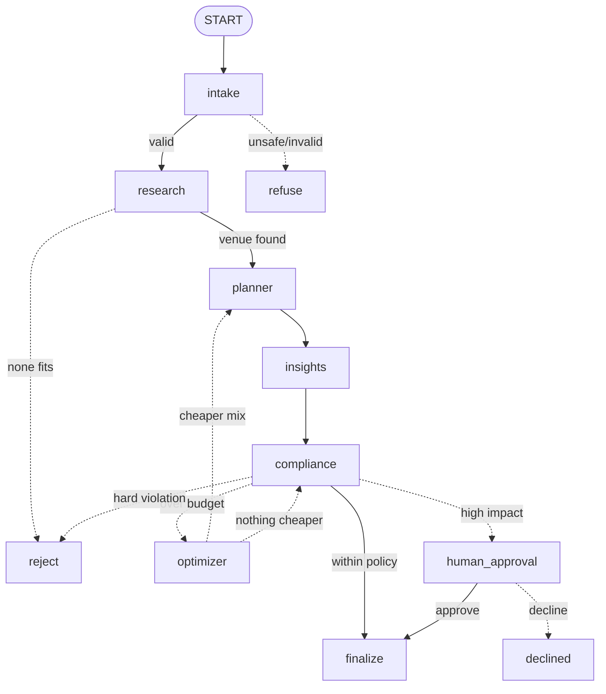

# EventPilot AI

**Describe an event in one sentence. Six LangGraph agents turn it into a costed, weather-checked, policy-validated plan, fix budget overruns on their own, and wait for a human to approve before anything is booked.**

> Derived from the open-source [Gatherly](https://github.com/naitikj9/Gatherly) project by naitikj9. See [NOTICE.md](NOTICE.md) (including the license note).

## Overview
Example request: *"Plan a wedding for 150 guests in Bangalore with a budget of ₹8 lakh on December 18, outdoors."*
This is a multi-agent system, not a chatbot: shared graph state, typed agent outputs, RAG over a vendor catalog, tool calling, conditional routing, a self-healing budget loop, human-in-the-loop approval and full execution tracing.

## Features
- Six specialist agents orchestrated with LangGraph, live agent streaming (SSE)
- Venue/vendor RAG, exact budget tool, timeline, weather risk, date intelligence (rejects past dates)
- Budget optimizer with **original vs optimized** comparison and the list of swaps
- Lean / Balanced / Luxe packages, plan health score (0-100), what-if simulator
- Countdown checklist, `.ics` and Markdown export
- Mandatory human approval, durable SQLite checkpoints
- Guest invite link: RSVP, food preferences, party playlist with votes, live countdown, guest `.ics`
- Admin console: plan list, agent pipeline view, approvals, token/cost usage
- Security and ops: admin token, rate limits, concurrency cap, run timeout, idempotency keys, LLM retries, prompt-injection guard, PII redaction, request IDs, JSON logs, Prometheus `/api/metrics`, `/api/ready`
- Dark and light theme (consumer app), responsive layout

## Screenshots
_Placeholders: add images under `docs/screenshots/` and link them here._
| Landing | Wizard | Live planning | Plan dashboard |
|---|---|---|---|
| `docs/screenshots/landing.png` | `docs/screenshots/wizard.png` | `docs/screenshots/live.png` | `docs/screenshots/plan.png` |

## Architecture

Details: [docs/ARCHITECTURE.md](docs/ARCHITECTURE.md).

## The six agents
| Agent | File | Role | Output |
|---|---|---|---|
| Intake | `src/agents/intake.py` | Free text → structured brief, first safety screen | `EventRequirements` |
| Venue & Vendor | `src/agents/venue.py` | RAG over the catalog, match capacity/city/budget/preferences | `VendorShortlist` |
| Planner | `src/agents/planner.py` | Timeline + exact budget via the budget tool | `EventPlan` |
| Insights | `src/agents/insights.py` | Weather risk, checklist, packages, health score (no LLM) | `Insights` |
| Compliance | `src/agents/compliance.py` | Deterministic policy checks: approve / escalate / reject / optimize | `ComplianceResult` |
| Budget Optimizer | `src/agents/optimizer.py` | Cheaper swaps that keep requirements, then re-validates | `VendorShortlist` |

## Tech stack
Python 3.12, LangGraph, LangChain (OpenAI), Pydantic, FastAPI, MongoDB (optional; in-memory fallback), SQLite checkpoints, React 18, Tailwind CSS, Framer Motion, Docker Compose, GitHub Actions.

## Project structure
```
src/            graph, state, schemas, agents/, tools/, guardrails, scoring, exporters, whatif
backend/        FastAPI app (server.py) and core/ (settings, storage, security, observability)
frontend/       React app (pages/, components/, lib/)
data/knowledge_base/vendors.json   sample vendor catalog (not verified live prices)
tests/          offline and API tests (fake LLM); tests/test_cases.py needs a real key
docs/ARCHITECTURE.md
```

## Installation and local run
```bash
python3 -m venv .venv && source .venv/bin/activate
pip install -r backend/requirements.txt pytest
cp .env.example .env            # set OPENAI_API_KEY and ADMIN_TOKEN
python -c "import secrets; print(secrets.token_hex(24))"   # use as ADMIN_TOKEN
uvicorn backend.server:app --port 8001 --reload

cd frontend && npm install
REACT_APP_BACKEND_URL=http://localhost:8001 npm start        # http://localhost:3000
```
CLI only: `python -m src.app "Plan a wedding in Bangalore for 150 guests, budget 8 lakh"`.

## Environment
All variables are documented in `.env.example`. Never commit `.env`; no keys are hardcoded.

## Docker
```bash
export OPENAI_API_KEY=sk-...  ADMIN_TOKEN=$(python -c "import secrets;print(secrets.token_hex(24))")
docker compose up --build     # web :3000, api :8001
```

## Testing
```bash
CHECKPOINTER=memory python -m pytest -q       # offline + API tests, no key needed
cd frontend && CI=true npm run build
```

## API (selection)
`POST /api/plans`, `POST /api/plans/stream` (SSE), `GET /api/plans/{id}`, `POST /api/plans/{id}/decision` (admin), `GET /api/plans` (admin), `GET /api/plans/{id}/export.ics|export.md`, `POST /api/plans/{id}/whatif`, `GET /api/plans/{id}/invite`, `POST /api/plans/{id}/rsvp`, `GET|POST /api/plans/{id}/songs`, `GET /api/health|ready|metrics`. Interactive docs at `/docs` when the API runs.

## Security considerations
Admin token with constant-time compare; per-IP rate limits; prompt-injection screening before LLM calls; PII redaction in traces; idempotency keys; guest names visible to admins only; CORS should be restricted via `CORS_ORIGINS` in production.

## Limitations and future work
- Vendor data is a sample catalog; prices are **not** verified real-world quotes.
- "Booking" is a status change; there are no external vendor integrations.
- The admin console is dark-only; the dark/light toggle applies to the consumer screens.
- Weather risk uses seasonal climatology, not live forecasts.
- Future: live vendor APIs, real forecast data, multi-currency, per-user accounts.
