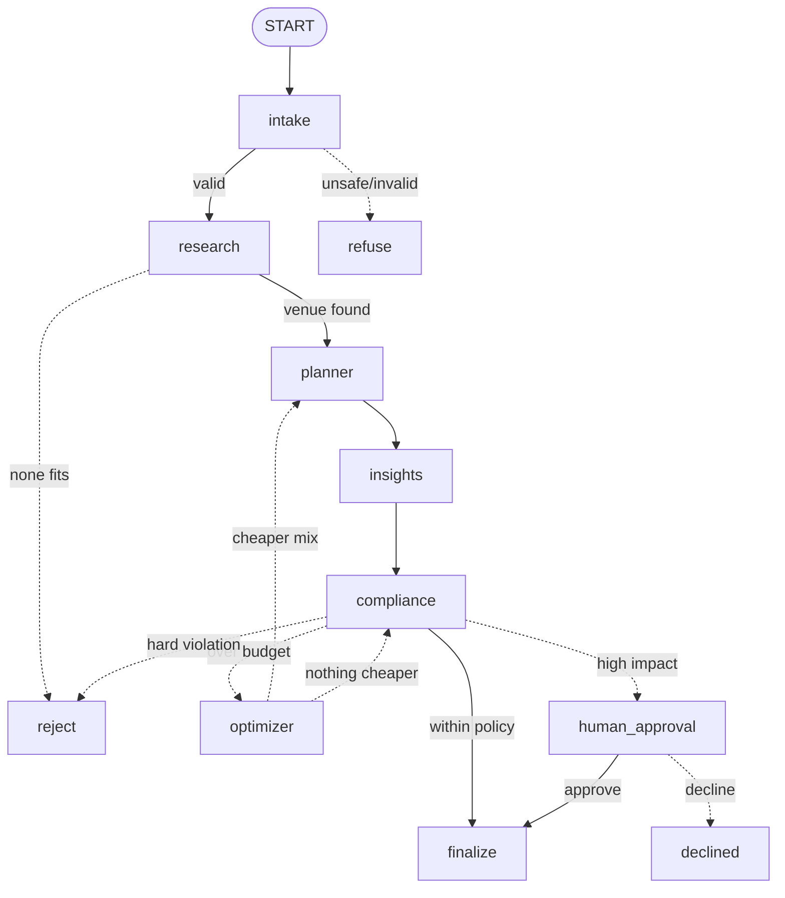

# Architecture

EventPilot AI is a LangGraph state machine. One shared state dict flows through
six specialist agents; conditional edges decide what runs next; a human-approval
node can pause the whole graph.

## Shared state (`src/state.py`)
`PlannerState` holds each agent's typed output (`requirements`, `shortlist`,
`plan`, `insights`, `compliance`), the optimizer loop fields (`optimizer_attempts`,
`optimization_log`, `optimizer_stuck`, `original_total_inr`), the outcome
(`status`, `human_decision`, `final_message`) and an append-only `log` (reducer
`operator.add`). Agents return partial updates; LangGraph merges them.

## Structured handoffs (`src/schemas.py`)
Every LLM-backed agent returns a Pydantic model (`EventRequirements`,
`VendorShortlist`, `EventPlan`, `ComplianceResult`). `src/llm.py::invoke_structured`
validates output and retries with backoff on schema errors, timeouts, rate limits and 5xx.

## RAG and tools
- **Retrieval** (`src/tools/retrieval.py`): embeds `data/knowledge_base/vendors.json`
  into an in-memory vector store; the Venue agent retrieves candidates, then the
  model picks from them. Prices always come from catalog data, never from the model.
  The catalog is sample data, not verified live quotes.
- **Tools**: budget calculator, availability check, weather climatology, date
  parsing, checklist builder, package builder. The Insights and Compliance agents
  are deterministic (no LLM), so health scores and policy decisions are reproducible.

## Conditional routing and the self-healing loop
`compliance` returns approve / escalate / reject / optimize. When the only problem
is cost, `optimizer` swaps vendors greedily (respecting capacity, date and diet) or
drops unrequested extras, records the pre-optimization total once, and routes back to
`planner → insights → compliance`. `OPTIMIZER_MAX_ATTEMPTS` bounds the loop; if nothing
cheaper exists the plan goes to a human.

## Human approval
`human_approval` calls LangGraph `interrupt()`. State is checkpointed to SQLite
(`CHECKPOINT_DB`), so a restart does not lose pending plans. `POST /api/plans/{id}/decision`
(admin token required) resumes the graph with approve or decline. Only `finalize`
marks a plan booked, and it is unreachable without policy approval or an explicit human approve.
No external booking integration exists; "booked" is a status in this system.

## API layer (`backend/`)
FastAPI with admin auth (constant-time token compare), per-IP rate limits, concurrency
cap and run timeout, idempotency keys, SSE streaming (`/api/plans/stream`), request IDs,
JSON logs, Prometheus metrics (`/api/metrics`), readiness (`/api/ready`), and MongoDB
storage with an in-memory fallback. Guardrails (`src/guardrails.py`) block prompt injection
before any LLM call and redact PII before traces are written.
